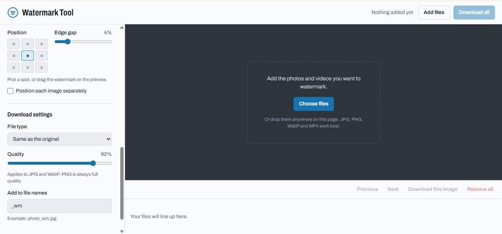
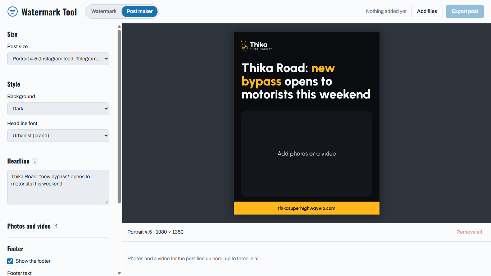

# Batch Watermark

**[Try it live](https://media-watermarking-tool.oumabarzil.workers.dev/)**, no install or setup required.

A browser-based tool that batch-watermarks photos and videos, and builds branded social posts from them: no install, no command line, no backend. Open a link, drop in a folder of media, download the finished set.

Built for a non-technical client running a Telegram news channel who was previously watermarking every photo and video by hand, one file at a time, in separate image and video editors.



## Why this exists

Watermarking a handful of files by hand is fine. Watermarking dozens of them, consistently, every day, is not, and asking a non-technical person to install FFmpeg and run terminal commands isn't a real option. This is a single link that does the whole job in the browser: no software to install, and no server to trust with the files, since nothing is ever uploaded.

## Features

- **Batch upload**, mixed photos and videos in one go, with thumbnails and drag-and-drop
- **Live preview** with drag-to-position, a 9-point placement grid, and per-file or shared positioning
- **Four watermark styles** (round badge, plain text, rounded label, tiled) with full control over font, color, opacity, rotation, and spacing
- **Photo export** to JPG, PNG, or WebP
- **Video export** to MP4 (H.264), with audio preserved and no re-encode where possible
- **Moving watermark** (video only): slides across the frame and off the far edge on a continuous loop, in any of the four cardinal directions, at an adjustable speed. Harder to crop or paint out than a fixed watermark
- **Progress and cancel** for long video jobs, per file and overall
- **Smart downloads**: a ZIP for small batches, straight-to-folder saving for large ones, so a big video batch can't crash the tab
- **Installable** as a lightweight app (PWA): pin it to the taskbar, works offline after first load
- **Adapts to the screen**: the same page reflows into a phone-native layout below 880px wide (a bottom sheet for settings instead of a sidebar, larger touch targets), with a separate compact mode for landscape phones. The desktop layout is untouched above that width
- **Remembers your settings** in this browser, so a returning user doesn't have to rebuild the watermark from scratch on every visit

### Post maker

A second mode, switched from the top bar, turns a headline and up to three photos, or a video with up to two photos, into a branded post for the client's channels.



- **Four sizes**: portrait 4:5 (1080 x 1350), square (1080 x 1080), landscape 16:9 (1600 x 900) and story 9:16 (1080 x 1920), each with its own layout of logo, headline, panels and footer
- **Headline** in the brand typeface that sizes itself to fit; words wrapped in `*stars*` turn amber, and a warning appears if the text is too long even at the smallest size
- **Panels** with rounded corners: drag to move the picture inside, zoom in or out with a slider, the mouse wheel or a pinch (out as far as the whole picture), reorder and remove. Each crop survives a change of size
- **Style**: the dark brand background or a light one, and a choice of five headline fonts
- **One video per post**: a post with a video exports as an MP4 the length of the clip, with its sound; without one it exports as JPG or PNG at the exact size
- **Footer** strip with the site address or any other text, and an optional watermark using the Watermark mode's settings
- Each mode keeps its own files and settings, so switching back and forth loses nothing

## How it works

Both media types share one rendering path. A single `drawWatermark()` function paints the watermark onto any canvas at any resolution:

- For a **photo**, that canvas *is* the exported file.
- For a **video**, the same function renders a full-frame transparent PNG at the clip's exact resolution. [`ffmpeg.wasm`](https://github.com/ffmpegwasm/ffmpeg.wasm) then composites that PNG over the video with an `overlay` filter and re-encodes with `libx264`.

Because one function produces both, the watermark is guaranteed to look identical on a photo and a video, by construction, not by careful tuning of two separate code paths.

Post maker follows the same idea. One `drawPost()` function paints the whole post, and the live preview calls it too, at full size under a canvas scale, so line breaks, font sizes and crops in the preview are the ones in the file.

- For a post with **photos only**, the canvas `drawPost()` paints is the exported image.
- For a post with a **video**, `drawPost()` paints everything except the video into a PNG with a transparent rounded hole where the video goes. `ffmpeg.wasm` scales and crops the video with the same numbers the preview uses, places it on the post background at the panel's position, and overlays the PNG. The PNG's opaque corners give the video its rounded corners.

The app is vanilla JS split into plain ES modules under `src/`, served as they are: no framework and no bundler. `build.mjs` only copies and checks files. Video runs through `ffmpeg.wasm` using its single-threaded core. The multi-threaded core stalled on every export in desktop Chrome, while the single-threaded one finishes a 10-second clip in under 20 seconds. [`DEPLOY.md`](DEPLOY.md) has the details.

## Try it locally

No dependencies to install for the tool itself. [Node.js](https://nodejs.org) is only used to run a tiny local dev server that sends the right headers.

```bash
node serve.mjs
```

Then open <http://localhost:8080>.

The page has to be served. Opening `batch-watermark.html` straight from disk does not work, because browsers do not load ES modules from a file. To use the tool with no setup at all, open the [live link](https://media-watermarking-tool.oumabarzil.workers.dev/).

## Deploying

```bash
node build.mjs
```

writes a `dist/` folder containing only what needs to ship. The live site is a Cloudflare Workers project connected to this repository: each push to `main` runs `node build.mjs` and deploys `dist/`. Full deployment notes are in [`DEPLOY.md`](DEPLOY.md).

## Limits

- Videos over 400 MB are rejected at upload (the browser can't reliably handle more); over 150 MB shows a warning that it will take a while
- Video processing is one file at a time, with no hard cap on how many files can be queued
- Video encoding is CPU-bound WebAssembly, not hardware-accelerated. Expect it to be slower than a native editor, especially on a phone or an older machine
- A post holds up to three panels, and at most one of them can be a video. A post video is encoded at the full post size, which takes roughly two to five times the clip's length on a laptop

## Stack

Vanilla JavaScript, HTML5 Canvas, [`ffmpeg.wasm`](https://github.com/ffmpegwasm/ffmpeg.wasm), [JSZip](https://stuk.github.io/jszip/). No framework, no build tooling, no backend.

## License

MIT. See [LICENSE](LICENSE).

